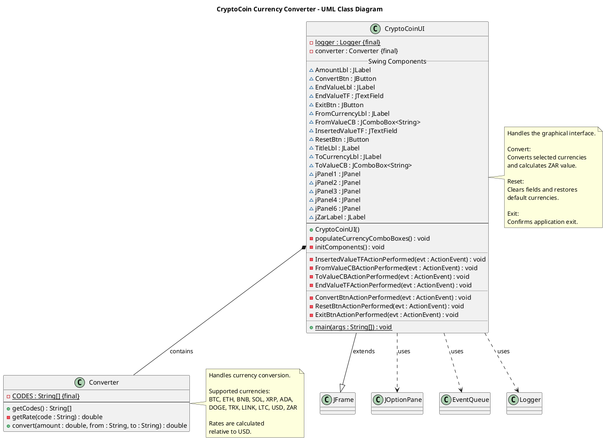

## Code 

## How to Use

1. Go to [plantuml.com](https://www.plantuml.com/)
2. Paste code in the block 

![[Pasted image 20261106100603.png]]

3. Screenshot the code 

![[Pasted image 20261106100544.png]]